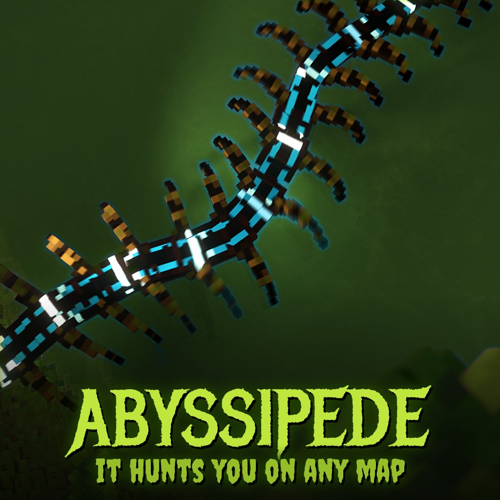

# Abyssipede - something long is moving in the dark

On the Steam Workshop: [Abyssipede](https://steamcommunity.com/sharedfiles/filedetails/?id=3833158470)

A 17 m armoured centipede hunts you on any map. Black shingled plates, glowing markings down its back, red eyes, venom claws and forty legs that never stop moving. It swims through flooded wrecks and flies through the air on land, slips through doors and corridors, and bites through whatever is in its way.

## How it hunts
- It **follows your light and your noise**: a lit flashlight in its sight, gunfire, explosions, anything loud. Up close it finds you anyway.
- It stalks, then charges. When it stops dead and opens its claws, **get out of the way**: the lunge comes next.
- If its claws close on you, it **drags you back to its lair**. There is no struggling free: only **hurting it** makes it let go, so stay close to your friends.
- It reads every map on its own (no markers needed) and tunnels through walls and floors when it has to. What it can't bite through, it backs away from and finds another way.
- Badly hurt, it flees to its lair and comes back later.

## Fighting back
Shoot it (the head hurts most), blow it up, hit it with a sledge. On the **Titanic Wreck** map the harpoon gun's spears hit it hard.

## Settings
- **Options** in the Mod Manager: 1 to 3 on each map.
- The host can place more from the spawn menu (Creatures > Abyssipede), up to 6.

## Multiplayer
The host turns it on under Global mods. Each player's game draws the body itself; the host runs the brain.

## For mod and map makers
Your own weapons can hurt it through two registry strings on the host: **abyssipede.hitpoints** (where its hit points are, written every tick) and **abyssipede.damage** (append "x y z amount;" per hit).

## Install

Subscribe on the [Steam Workshop](https://steamcommunity.com/sharedfiles/filedetails/?id=3833158470), or clone this repository into
`Documents/Teardown/mods/abyssipede`. Enable it under **Global mods** (in multiplayer the host does).

## Credits

Made by AgeOfAlgorithms and Claude (Anthropic). MIT licence.
